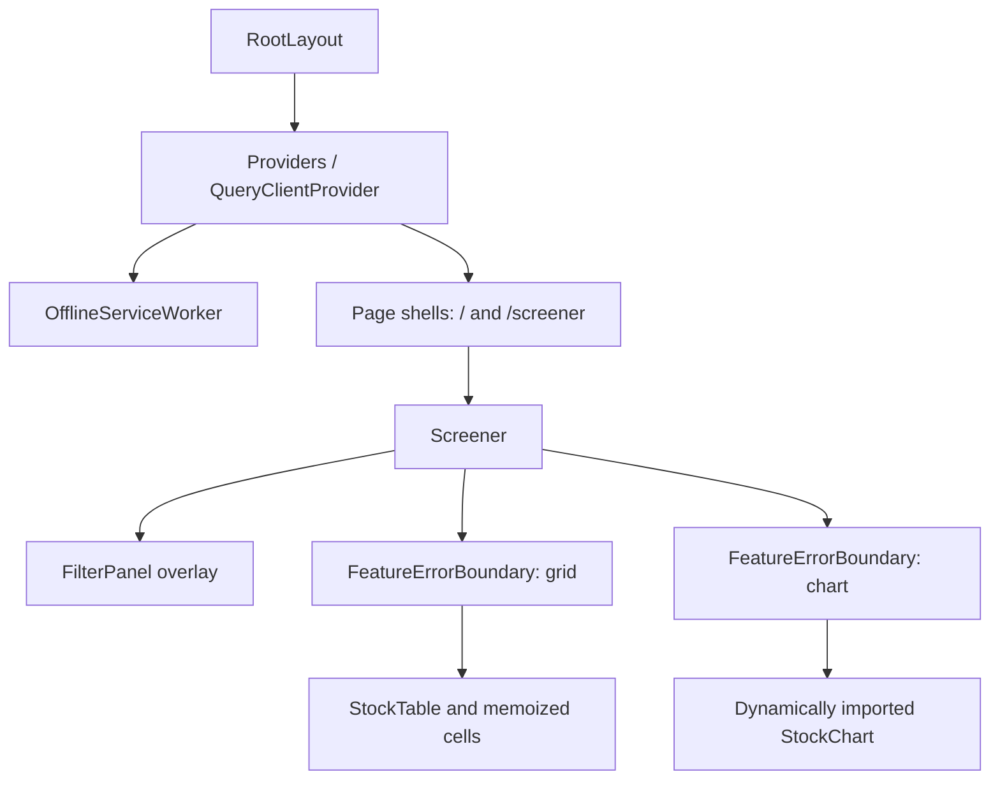
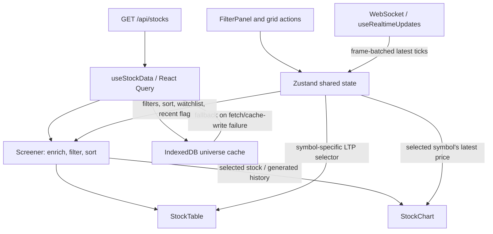

# ScreenerX Architecture

This document describes the current implementation for Part D Task 1.6 (PDF p. 53). Stocks, historical candles and streamed prices are simulated. The rationale below explains the code; it is not a verified account of the original development process.

## Runtime and entry points

| Entry point                        | Responsibility                                                          | Source                                                |
| ---------------------------------- | ----------------------------------------------------------------------- | ----------------------------------------------------- |
| `/` and `/screener`                | Server page shells render the same client `Screener`.                   | `src/app/page.tsx`, `src/app/screener/page.tsx`       |
| Root layout                        | Metadata, shared provider and service-worker registration component.    | `src/app/layout.tsx`, `src/components/Providers.tsx`  |
| `/[symbol]`                        | Server-rendered placeholder, separate from the working inline chart.    | `src/app/[symbol]/page.tsx`                           |
| `GET /api/stocks`                  | Generates 5,000 records; module-local cache reused for five minutes.    | `src/app/api/stocks/route.ts`, `GET`                  |
| `GET /api/stocks/[symbol]/history` | Generates 252 candles or returns 404. Main UI does not call this route. | `src/app/api/stocks/[symbol]/history/route.ts`, `GET` |
| WebSocket process                  | Generates ticks and broadcasts to connected clients; default port 3001. | `server/simulator.ts`, `tick`; `server/ws-server.ts`  |

`npm run dev` starts Next.js and the simulator using `concurrently`. `npm start` starts only Next.js; the stream needs a separate process. Browser setting `NEXT_PUBLIC_WS_URL` defaults to `ws://localhost:3001`. Server settings include `WS_PORT` and `WS_UPDATE_INTERVAL_MS`. These local runtime paths are not evidence of a working hosted deployment. Sources: `package.json`, `src/hooks/useWebSocket.ts`, `server/ws-server.ts`.

## Component hierarchy

This diagram shows composition, not network requests.

`Screener` also renders connection status, matching counts, offline banner, mobile controls and metric targets. Targets displayed on screen are not measurements. `StockChart` uses `next/dynamic` with SSR disabled and a loading placeholder, and renders after selection. Filters have no feature error boundary. Sources: `src/components/Screener.tsx`, `Screener`; `src/components/ErrorBoundary.tsx`, `FeatureErrorBoundary`.

## State ownership

| Category         | Owner                   | Contents and lifetime                                                                     |
| ---------------- | ----------------------- | ----------------------------------------------------------------------------------------- |
| Fetched universe | TanStack Query          | Key `['stocks']`; five-minute stale time. `Providers` creates a stable QueryClient.       |
| Shared UI        | Zustand                 | Filters, sort, selected symbol, watchlist and connection status.                          |
| Live data        | Zustand                 | Latest `LivePrice` per symbol in a Map, separate from fetched records.                    |
| Derived results  | `Screener` memoization  | Watchlist/recent flags, then filtered and sorted records.                                 |
| Filter UI        | `FilterPanel` state     | Search, accordion sections, dropdown expansion and collapse state.                        |
| Grid UI          | `StockTable` state      | Active cell, widths/pinning, menus and shortcut dialog. `LivePriceCell` owns flash state. |
| Chart UI         | `StockChart` state/refs | Timeframe, indicator settings, drawings and imperative chart/series instances.            |

Sources: `src/components/Providers.tsx`, `src/hooks/useStockData.ts`, `src/stores/stockStore.ts`, and the named components.

## State and data flow

HTTP and WebSocket paths start independently when `Screener` mounts.

1. `useStockData` fetches the universe, writes it to IndexedDB, and returns it to React Query. Its catch path tries cached records. Browser online events invalidate the query. A cache-write failure also enters this catch path.
2. Controls update Zustand. `Screener` adds watchlist and recent-update flags, then calls `filterStocks` and `sortStocks`. The engine compiles its optimized AND/OR tree once per execution and short-circuits each record. Numeric comparisons reject non-finite/incompatible operands; missing sort values remain last in either direction. Sorting happens outside TanStack Table's row model.
3. `useRealtimeUpdates` buffers ticks in a ref-held Map and flushes once per requested animation frame. Multiple ticks for a symbol collapse to its latest value; this is not a lossless archive.
4. `LivePriceCell` subscribes to its symbol's price and flashes for 300ms on a price change, restarting the timer on the next change. `LiveChangeCell` subscribes to the symbol's daily absolute/percentage change. Row selection stores the symbol and reveals/focuses the chart panel. `Screener` generates history locally and patches its final candle using the selected symbol's tick. The store retains high/low over committed live batches, so a subsequent close cannot erase earlier observed extrema; the historical daily high/low remain bounds too. These extrema cover this in-memory demo session, with no exchange-day rollover. Within-frame intermediate ticks are coalesced by the client. Price-only messages supply no new volume or candle-opening event, so volume remains the generated snapshot and ticks patch the final simulated session rather than append dated live candles.

Sources: `src/hooks/useStockData.ts`, `useStockData`; `src/hooks/useWebSocket.ts`, `useRealtimeUpdates`; `src/components/Screener.tsx`, `filterableStocks`, `filtered`, `history`, `chartData`; `src/components/DataGrid/StockTable.tsx`, `LivePriceCell`, `selectRow`.

## Persistence and recovery

The filter panel exposes 31 criteria: 20 numeric ranges, four classification multiselects, five technical radio groups and two boolean switches. Each range has controlled min/max inputs and two slider handles. One-sided bounds use `gte`/`lte`; two-sided bounds use `between`. Clearing one bound preserves the other. Controls read presets by field and replace existing IDs for that field on edit, preventing duplicate predicates. Industry options currently use a static complete list rather than sector-dependent choices.

The calculated high-distance criterion is `(52-week high - price) / high * 100`; low-distance is `(price - 52-week low) / low * 100`. Labels explicitly describe these distances, and invalid denominators do not match. These currently use snapshot prices, as other numeric screening does. The debt/equity slider extends to 15 to accommodate the mock banking range despite A6.1 listing 10. Sources: `FilterPanel`, `RANGE_FILTERS`; `src/types/stock.ts`, `FilterField`; `createPredicate`.

| Storage                      | Saved data                                                               | Restore behavior                                                                                                                                          |
| ---------------------------- | ------------------------------------------------------------------------ | --------------------------------------------------------------------------------------------------------------------------------------------------------- |
| API process memory           | Universe and timestamp                                                   | Five-minute module-local reuse; not a shared database.                                                                                                    |
| localStorage                 | Watchlist array under `stock-screener`                                   | Custom persist `merge` validates strings and constructs a Set before notifying listeners. Other saved fields cannot replace actions/runtime state.        |
| IndexedDB                    | Universe and `cachedAt`                                                  | Offline/network-failure fallback runs even on a cold offline mount. No expiry check on `cachedAt`; saved results are marked stale in the UI.              |
| Service-worker Cache Storage | Root shell, HTML-linked initial assets and visited hashed Next.js assets | Production-only registration. Navigation falls back to cached root; API requests are excluded. Unvisited dynamic chart chunks may be unavailable offline. |

Sources: `src/app/api/stocks/route.ts`; `src/stores/stockStore.ts`, `partialize`, `merge`; `src/lib/stockCache.ts`; `src/components/OfflineServiceWorker.tsx`; `public/sw.js`.

`useStockData` uses `networkMode: 'always'` so an initially offline query can execute the IndexedDB fallback instead of pausing. API fetch/envelope failures fall back to saved records; cache read errors preserve the original network error, and cache write errors do not discard network data. Automatic query retries are disabled; reconnect always refetches, including when saved data is within the five-minute stale time. `Screener` warns when offline or using saved data, retains existing data on a refresh error, and explains when an offline first visit has no stock cache. The worker uses the `screenerx-shell-` cache prefix, removes only old versions of that namespace, saves initial HTML-linked JS/CSS during installation, awaits asset writes and updates the root shell after successful navigation. A first-ever offline visit cannot install the app. Browser production install/upgrade/navigation still needs manual verification; tests exercise hook recovery and worker handlers with mocked browser storage/network.

## Mock market model

`generateMockStocks(5000)` preserves 100 large-cap, 400 mid-cap, 1,500 small-cap and 3,000 micro-cap records. An independent seeded shuffle distributes sector profiles across cap buckets, removing the former dependency on sector order.

`generateRecentCloses` creates 60 seeded price changes anchored at the last price. Previous close, daily change and RSI(14) derive from that series using `calculateRSI`. Growth/valuation, cap/beta, sector/debt and movement/volume remain simulation heuristics.

`assignIndexMembership` ranks within cap categories. The default universe has 50 NIFTY 50, 50 distinct NIFTY Next 50, 30 overlapping Sensex, 100 mid-cap and 250 small-cap members. This is a mock eligibility model, not official exchange selection or actual constituents. Chart `generateHistory` now shares the recent-close series and extends older prices with a separate seeded simulation. Other generated technical fields remain heuristics.

Volume labels use the actual daily-to-average ratio: below 1x is `Below`, 1x to below 2x is `Above`, 2x to below 3x is `2x`, and at least 3x is `3x`. Large-move simulation includes ratios above 3x. The Technical Breakout preset selects the last two categories, matching its at-least-2x screening interpretation.

`useStockStore.applyPreset` replaces the complete active-filter list in one update and copies array values. It leaves selection, watchlist, sort and live prices intact. `FilterPanel` uses that action for all four predefined screeners. Preset tests compare results with independent financial conditions rather than applying the same engine twice. Sources: `src/stores/stockStore.ts`, `applyPreset`; `src/lib/presets.ts`; `src/__tests__/presets.test.ts`.

Sources: `src/lib/mockData.ts`, `generateMockStocks`, `repeatProfiles`, `generateRecentCloses`, `assignIndexMembership`, `generateHistory`; `src/lib/indicators.ts`, `calculateRSI`.

## Library decisions and trade-offs

### WebSocket simulator lifecycle

`server/ws-server.ts` validates environment settings, starts `createPriceSimulationServer` from `server/simulator.ts`, and requests cleanup on SIGINT/SIGTERM. The factory exposes startup readiness and an idempotent close method that waits for both the listening server and connected sockets. Timer ticks compensate for work time; per-symbol randomized deadlines advance from the previous deadline, with missed ticks dropped after a stall rather than replayed in a burst.

Prices use the exponential GBM step with its drift correction and a 0.1 floor, rather than the PDF's linear approximation. One update is a compressed `dt=1/252` simulated year step regardless of wall-clock frequency. Sector shocks share `sqrt(0.6)` exposure plus independent `sqrt(0.4)` noise, giving approximately 0.6 pairwise correlation within the same batch. Different scheduler batches do not share the same shock. Weekday opening/closing half-hours use 1.6 volatility; mid-session uses 0.7; out-of-hours/weekends continue at baseline 1 for demo use, without exchange holidays.

Messages keep the existing JSON contract. `change` and `changePercent` now refer to the stock's fixed previous close, rather than the prior tick. Each connection receives the same broadcast. Closed sockets are skipped; send failures terminate only that socket. A client with more than 1MiB buffered output is disconnected instead of growing an unbounded queue. This policy can discard ticks; it is not a lossless market-data feed.

Sources: `server/simulator.ts`, `readSimulatorConfig`, `createPriceSimulationServer`; `server/ws-server.ts`, `main`; `src/lib/priceSimulator.ts`; `src/__tests__/wsServer.test.ts` (real local WebSocket clients); `src/__tests__/priceSimulator.test.ts`.

### Chart interactions and PNG export

Native chart options enable wheel/pinch zoom and mouse/touch horizontal pan. Double-click fits both panes. Overlay coordinates refresh during pointer drags, wheel events, range changes, data changes and resizing. Optional drawings store time/price anchors and are scoped to a symbol/timeframe; their projected pixel coordinates change with the chart. Finishing a drawing returns to pan mode. Escape/pointer cancellation discards the draft, and clearing affects only drawings in the current view.

`composeChartPng` combines the main native `takeScreenshot()` canvas with the visible RSI screenshot, a title/indicator legend, the Bollinger polygon, volume-profile bars and committed drawings. It retains native pixel density and clips overlays to the main chart bounds. A failed capture/encoding shows an error instead of reporting success. The download filename includes symbol/timeframe. This is a composite chart export, not a capture of surrounding filter controls or the entire page.

Tests exercise composition geometry, download requests/failures, reset callbacks, data-anchor projection and cancellation with mocks. Browser gesture behavior and the actual PNG raster still require visual verification. Sources: `StockChart`, interaction handlers and `downloadChartAsImage`; `src/lib/chartExport.ts`; `src/__tests__/chartExport.test.ts`; `src/__tests__/StockChart.test.tsx`.

### Indicator calculation and rendering

Daily views calculate indicators using the available daily history before mapping results to the displayed time window, so a five-day view can display SMA(200). Intraday periods count five-minute bars; the long view uses weekly bars. Unavailable warmup values stay empty. RSI retains whitespace bars so its logical indices match the main chart, and range listeners synchronize both charts with a recursion guard.

The main effect registers typed line-series handles for SMA, EMA, the three Bollinger boundaries and RSI. A subsequent data effect updates the current points when only the latest candle changes; if an earlier candle or window changes, it replaces series data. It restores the logical range and does not recreate chart instances for ticks. Settings/toggle changes can rebuild instances, retaining the range for the same stock/timeframe. A translucent SVG polygon fills between Bollinger boundaries using chart time/price coordinates rather than shading an area down to a baseline.

Volume profile defaults to 40 buckets, configurable from 30 to 50. Each candle's volume is allocated in proportion to its low-high overlap with each bucket. This assumes uniform distribution within the candle; OHLCV does not reveal actual trade volume at each price. Flat-price candles preserve all volume in one bucket. The calculation uses the visible logical range and updates on range/data changes; bars use price coordinates on the right. Range subscriptions are removed during cleanup.

Sources: `src/lib/indicators.ts`, `calculateVolumeProfile`; `StockChart`, `lineData`, indicator setup, data-update effect, `profile`, `bandPolygon`; `src/__tests__/indicators.test.ts`; `src/__tests__/StockChart.test.tsx`.

### Base chart data and lifecycle

`generateHistory` returns exactly the requested number of Monday-Friday sessions ending on the latest weekday, anchored to the selected stock's last price, daily OHLCV and recent closes. Common suffixes are identical for short and long requests. This is not an exchange holiday calendar.

`selectTimeframe` in `src/lib/chartData.ts` uses 5/21/63/252 sessions for 1W/1M/3M/1Y. The 5Y option aggregates 1,260 simulated weekday sessions into calendar weeks, including partial weeks. These session counts approximate the labeled durations. The 1D option explicitly labels 75 synthetic five-minute bars for 09:15-15:30 IST; they preserve the source day's open, high, low, close and total volume and are not recorded intraday trades.

`StockChart` initializes when data first becomes available. Main chart creation no longer depends on the conditional RSI container. ResizeObserver resizes active instances and disconnects during cleanup. Crosshair tooltip values, including volume, come from source OHLCV by timestamp, rather than assuming a candlestick series retains custom volume data. Enabled indicator series now synchronize with chart data without rebuilding instances on price ticks.

Sources: `src/lib/mockData.ts`, `generateHistory`; `src/lib/chartData.ts`; `src/components/Chart/StockChart.tsx`; `src/__tests__/chartData.test.ts`; `src/__tests__/StockChart.test.tsx`.

These reasons are supported by the code; the alternatives are comparisons, not claims of historical evaluation.

| Choice                   | Rationale                                                             | Alternative               | Trade-off                                                                         |
| ------------------------ | --------------------------------------------------------------------- | ------------------------- | --------------------------------------------------------------------------------- |
| Next.js App Router       | Page shells, metadata and API routes together.                        | SPA plus separate API     | Server/client boundaries and a separate stream process.                           |
| React 18                 | Composition, hooks, lifecycle cleanup and memoization.                | Another UI framework      | Streaming requires careful effects and subscriptions.                             |
| TypeScript strict mode   | Explicit stock/filter/message contracts.                              | JavaScript                | Types do not validate incoming JSON; chart code still has `any` casts.            |
| TanStack Table + Virtual | Headless columns and two-axis virtualization.                         | AG Grid or ordinary table | Custom keyboard behavior and accessibility require application code.              |
| Zustand + Immer          | Selector subscriptions, immutable Map/Set updates via `enableMapSet`. | Redux Toolkit             | Broad subscriptions cause work; collections need explicit persistence conversion. |
| TanStack Query           | Fetch lifecycle, caching and invalidation.                            | SWR or manual fetch       | Snapshot and live map require reconciliation where needed.                        |
| Lightweight Charts       | Canvas candlesticks and series APIs.                                  | ECharts, D3, Recharts     | Indicators, annotations and accessible alternatives need custom work.             |
| Standalone `ws`          | Push updates and connection lifecycle simulation.                     | Polling or managed stream | Long-lived server needs separate hosting.                                         |
| `idb` + service worker   | Offline records plus shell/assets.                                    | localStorage-only cache   | Cache lifecycle and offline chunk availability need browser validation.           |
| Tailwind CSS             | Utility styling and shared animation definitions.                     | CSS Modules               | Repeated classes and interaction states need maintenance.                         |
| Vitest + Testing Library | Utility, store, hook and component tests.                             | Jest plus browser E2E     | jsdom/mocks do not prove FPS, canvas or offline recovery.                         |

Sources: `package.json`, `tsconfig.json`, `tailwind.config.ts`, `vitest.config.ts`, and the implementation modules above.

## Performance mechanisms

- Grid uses 36px rows, row overscan 10 and column overscan 3. Its vertical scroll margin accounts for the 36px header; scroll padding keeps programmatic targets clear of the header and 32px footer. Symbol-based row IDs preserve identity through sorting. Selected-stock highlighting is separate from the keyboard-active cell outline.
- `Screener` memoizes filtered/sorted records and chart input. It subscribes to the full live map only when the recent-update filter requires it; selected price has a separate selector.
- Memoized cells use symbol-specific price/watchlist selectors. Flash state stays local.
- `useRealtimeUpdates` buffers validated ticks by symbol and commits at most once per animation frame. Older/duplicate timestamps are ignored against pending and committed ticks. Invalid JSON and invalid fields are dropped. Each effect owns its socket, retry timer and frame; retired socket callbacks cannot affect a replacement or a StrictMode replay. Backoff bases grow from 1 to 16 seconds with 20% jitter and a hard 16-second cap, resetting on open. Browser `online` cancels a pending retry and reconnects immediately; the UI displays connecting, open, closed and reconnecting states. This does not add heartbeat detection for silently stalled connections.
- Chart code is dynamically imported.

Grid navigation shortcuts run only when the grid container itself receives the key event, leaving sort buttons, resize handles and other native controls independent. Tab follows normal document order. Filtering clamps the active row to the available results; Enter selects the stock and invokes the chart-reveal callback. The shortcut dialog focuses its close button, contains Tab navigation and restores previous focus on dismissal. Source: `StockTable`, keyboard and dialog effects.

These mechanisms are not measured guarantees. `PERFORMANCE_REPORT.md` lacks the complete browser evidence required by Part D Tasks 6.1/6.5. Sources: `StockTable`, `src/lib/virtualGrid.ts`, `Screener`, `useRealtimeUpdates`.

`filterStocksWithMetrics` measures filter preparation/execution and logs records, matches and duration only in development. `executeFilterPipeline` reports total elapsed time including filtering, sorting and pagination. Neither metric includes React rendering or browser paint. Source: `src/lib/filterEngine.ts`.

## Current gaps

| Area                 | Remaining boundary                                                                                                                               | Source                                                            |
| -------------------- | ------------------------------------------------------------------------------------------------------------------------------------------------ | ----------------------------------------------------------------- |
| Live screening       | LTP and daily change cells stream live, but filters/sort still use snapshot values. Recent-update membership has no expiry.                      | `Screener`, `filterableStocks`; `LivePriceCell`, `LiveChangeCell` |
| Filters              | 31 criteria are available; no AND/OR editor despite engine support.                                                                              | `FilterPanel`; `src/lib/filterEngine.ts`                          |
| Chart                | Native gesture feel and exported-image visual quality still require browser verification.                                                        | `StockChart`; `calculateVolumeProfile`                            |
| Routes/APIs          | Detail placeholder and only universe/history REST routes.                                                                                        | `src/app/[symbol]/page.tsx`; `src/app/api`                        |
| Accessibility/layout | Missing filter boundary, chart data-table/high-contrast alternatives; desktop split layout incomplete; browser accessibility validation pending. | `Screener`, `StockTable`, `StockChart`                            |
| Validation           | Automated tests do not establish browser FPS, memory, Web Vitals, full PNG export or offline recovery.                                           | `src/__tests__`; `vitest.config.ts`                               |

Update this document as subsequent repair tasks change these boundaries.
