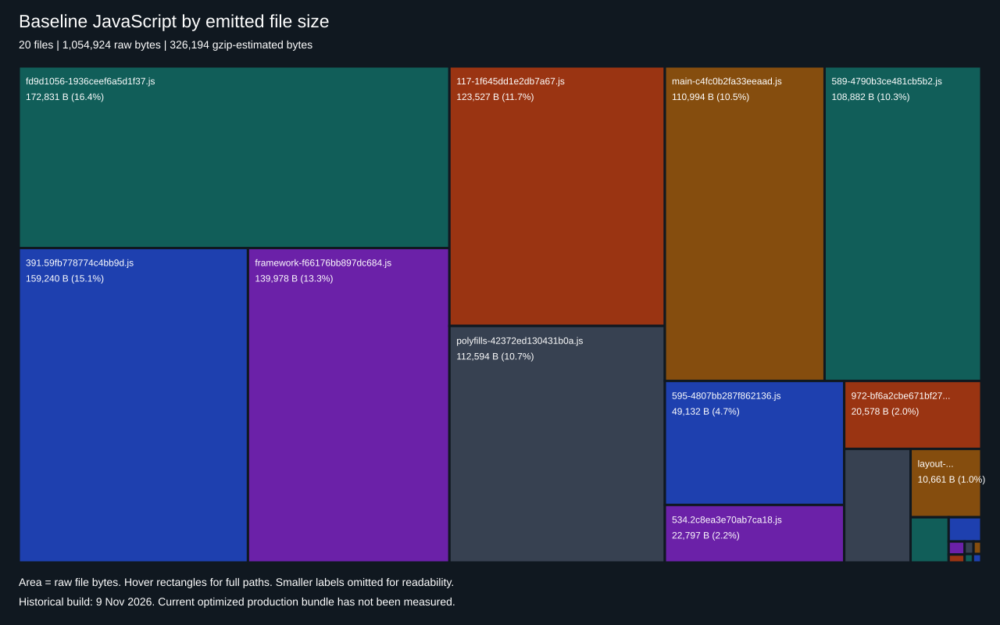

# ScreenerX performance report

Updated: 10 November 2026 (IST). Covers Tasks 6.1, 6.2, 6.3 and 6.5. Task 6.4 — Responsive Design was explicitly skipped.

## Result and acceptance status

The report records one supplied Lighthouse run, two local algorithm runs, a historical production bundle audit, and the completed optimization checks. It does **not** establish a controlled browser before/after improvement or full performance acceptance for the current code.

- Supplied Lighthouse run: Performance **100**, Accessibility **100**, Best Practices **100**, SEO **91**. Its IndexedDB warning prevents treating it as a verified clean first visit. The audited source revision and settings are not retained in the supplied PDF.
- Current-source pure-function benchmarks are below the filter/sort thresholds on the measured machine. They exclude input handling, React rendering, network, layout and paint.
- Task 6.2 code changes and Task 6.3 accessibility changes are implemented and covered by regression checks. Browser gains and full WCAG AA conformance remain unverified.
- The latest Task 7.1 coverage run passed **all 285 tests across 23 files**; TypeScript and lint passed. Aggregate coverage is 96.29% lines/statements, 91.94% branches and 86.12% functions; see [COVERAGE_REPORT.md](COVERAGE_REPORT.md) for scope. The current optimized production build, screenshots before/after, scroll FPS, WebSocket paint latency and browser memory remain pending.

## Evidence register

| Evidence                                    | Date                            | Source and scope                                                                                                                                                      |
| ------------------------------------------- | ------------------------------- | --------------------------------------------------------------------------------------------------------------------------------------------------------------------- |
| Original algorithm run                      | 9 Nov 2026, 13:49:03 UTC        | [algorithm-results.json](audit/algorithm-results.json); warm Node pure-function measurements                                                                          |
| Current-source algorithm run                | 10 Nov 2026, 05:32:44 UTC       | [algorithm-results-post-6.2.json](audit/algorithm-results-post-6.2.json); same fixture and sampling method                                                            |
| Original production bundle and API snapshot | 9 Nov 2026, 13:48:00 UTC        | [bundle-results.json](audit/bundle-results.json); emitted file sizes and decoded API payload                                                                          |
| Supplied Lighthouse PDF                     | Printed 9 Nov 2026, 7:29 PM     | [download.pdf](https://chatgpt.com/library?file_id=libfile_f0555695ada4819187ea5b2e1d40cc78&account_id=personal); localhost:3100, one recorded run                    |
| Additional uploaded Lighthouse PDF          | Same visible scores and metrics | [download(1).pdf](https://chatgpt.com/library?file_id=libfile_7565ddc5c88c8191903f02f6acf0b67f&account_id=personal); not evidence of an independent before/after pair |
| Accessibility implementation/checks         | 10 Nov 2026                     | [Task 6.3 record](progress/task-6.3.md); keyboard, naming, focus, grid semantics and sampled contrast                                                                 |

The original Task 6.1 audit did not collect browser measurements. The supplied Lighthouse PDFs are now recorded separately, rather than maintaining the outdated claim that no Lighthouse evidence exists. The historical bundle and timings are retained unchanged; the latest algorithm run has a separate file.

## Lighthouse and Web Vitals

| Metric               | Recorded result | Requirement / interpretation                                             |
| -------------------- | --------------: | ------------------------------------------------------------------------ |
| Performance score    |             100 | Above the >90 score target in this single supplied run                   |
| Accessibility score  |             100 | Automated checks only; not proof of WCAG AA conformance                  |
| Best Practices score |             100 | Single supplied run                                                      |
| SEO score            |              91 | Single supplied run                                                      |
| FCP                  |           0.2 s | Supplemental lab metric                                                  |
| LCP                  |           0.4 s | Below 2.5 s in this run; current optimized revision unverified           |
| CLS                  |               0 | Below 0.1 in this run; not proof across interactions                     |
| FID                  |    Not provided | Required by the assignment; no field interaction measurement available   |
| TTFB                 |    Not provided | Requires navigation/server timing evidence                               |
| TBT                  |            0 ms | Supplemental lab metric; not a substitute for FID or interaction latency |
| Speed Index          |           0.5 s | Supplemental lab metric                                                  |
| TTI                  |    Not provided | No defined, retained measurement                                         |

The PDF explicitly warns that stored IndexedDB data may affect loading performance. Browser version, throttling, cache state, source commit and chart-selection state are not established by the retained excerpt, so this run is neither a verified clean baseline nor a verified post-optimization result. No percentage improvement is claimed.

The report also flags a 4,272 KiB network payload, ten non-composited animations, potential forced reflow and approximately 11 KiB of legacy JavaScript savings. These are audit findings, not measurements of time saved by the changes below.

### Before/after screenshot evidence

The linked PDFs retain the supplied Lighthouse output. Distinct labeled screenshots for both a baseline revision and the final revision are **not available** in the repository. They remain an open Task 6.5 evidence item. No synthetic score screenshot has been created.

## Local filter, sort and indicator benchmarks

Both runs used Node v22.14.0 on an Intel Core i5-1240P, 5,000 seeded stocks, 20 warmups and 100 measured samples per operation, unthrottled. Timing values below are milliseconds. The current run was executed after the 6.2/6.3 changes.

| Operation                                 | Returned records / values | Original median / p95 | Current median / p95 | Current maximum |
| ----------------------------------------- | ------------------------: | --------------------: | -------------------: | --------------: |
| five broad filters                        |                     5,000 |           1.02 / 2.59 |          0.64 / 1.78 |            2.31 |
| five selective filters                    |                       112 |           0.38 / 0.77 |          0.37 / 0.98 |            1.63 |
| sort marketCap ascending                  |                     5,000 |           1.09 / 4.01 |          1.22 / 3.11 |            3.83 |
| sort companyName ascending                |                     5,000 |           4.41 / 7.08 |          4.00 / 6.48 |            8.61 |
| sort nullable pe descending               |                     5,000 |           4.79 / 9.65 |         4.84 / 13.35 |           15.41 |
| default chart indicators over 1260 closes |                     1,260 |           0.11 / 0.22 |          0.09 / 0.13 |            0.34 |

Sources: [audit-algorithms.mjs](scripts/audit-algorithms.mjs), [filterEngine.ts](src/lib/filterEngine.ts), [indicators.ts](src/lib/indicators.ts), [mockData.ts](src/lib/mockData.ts).

The broad filter fixture makes all 5,000 records reach all five numeric predicates. The selective fixture returns 112 records and can exit early. Indicator work covers SMA 20/50/200, EMA 12/26, Bollinger 20/2 and RSI 14 on 1,260 closes, with every indicator enabled.

These runs show pure filtering and sorting below 200 ms and 150 ms respectively on this machine. They do not measure complete user-visible filtering/sorting. The optimizations did not change these pure algorithm implementations: variation between the runs must not be attributed to React render isolation, persistence changes or disabled-indicator gating. No algorithm speedup is claimed.

## Bundle and payload analysis

These values describe the **9 November baseline build**, not the current optimized bundle.

| Item                                         |                   Recorded size | Meaning                                                 |
| -------------------------------------------- | ------------------------------: | ------------------------------------------------------- |
| `/` and `/screener` first-load JavaScript    |                          139 kB | Historical Next build estimate; not measured wire bytes |
| Shared first-load JavaScript                 |                         87.2 kB | Historical Next build estimate                          |
| Emitted JavaScript                           |       20 files; 1,054,924 bytes | All emitted routes, lazy chunks and runtime assets      |
| Sum of individually gzipped JavaScript files |                   326,194 bytes | Local gzip estimate, not one route's transfer           |
| Lazy chart chunks                            | 182,037 raw / 57,949 gzip bytes | Historical manifest-listed chunks 391 and 534           |
| Stock API decoded JSON                       |                 4,216,989 bytes | Observed 5,000-record response                          |
| Stock API local gzip estimate                |                   685,580 bytes | Compression estimate, not measured transfer             |



[Open the full treemap](audit/bundle-treemap-baseline.svg). Rectangle area is proportional to **raw emitted file bytes** in `bundle-results.json`. This is a file-level treemap, not a dependency/module analysis from `@next/bundle-analyzer`, and it includes files that are not requested on initial screener load. Hover titles expose full paths and exact sizes. Source data sums to 1,054,924 bytes across 20 files.

The chart was already dynamically imported when the baseline was recorded; its lazy chunks cannot be claimed as new savings from Task 6.2. A new production build, module treemap and matching network capture remain pending. The last attempted production rebuild failed with `EPERM` creating `.next/types/app`; a historical successful build does not verify the current source.

## Applied optimizations and before/after evidence

“Before” descriptions below come from the inspected source, unless a numeric measurement is explicitly named. Tests establish behavior; they do not establish browser frame-time savings.

| Change                                | Before                                                                               | After                                                                                                | Evidence / limit                                                                                                                                   |
| ------------------------------------- | ------------------------------------------------------------------------------------ | ---------------------------------------------------------------------------------------------------- | -------------------------------------------------------------------------------------------------------------------------------------------------- |
| Selected chart subscription isolation | Selected-symbol ticks notified `Screener`, whose render included the grid            | `SelectedStockChart` and `SelectedStockPrice` own their tick subscriptions                           | Realtime integration test verifies candle updates without extra grid renders; recently-updated filtering intentionally still observes the live map |
| Watchlist persistence                 | Persist middleware serialized/wrote the watchlist on unrelated updates               | Set projection is reused and unchanged storage writes are skipped before serialization               | Regression sends 20 price batches plus UI updates without an additional write, then verifies edits, hydration and storage clearing                 |
| Hidden indicator calculations         | Disabled overlays still calculated their indicators                                  | SMA, EMA, Bollinger, RSI and volume profile skip calculations when disabled                          | Chart test verifies zero disabled-calculator calls after new candle data and recomputation when re-enabled; no measured CPU percentage saving      |
| Cell memoization                      | Change cells used default memo comparison; symbol cells could retain an old callback | Every cell renderer has custom comparisons; static cells compare symbol identity and symbol handlers | Table tests cover live values, selection and watchlist behavior                                                                                    |
| Existing memoized filter/sort         | Already used `useMemo`                                                               | Retained                                                                                             | Not a new optimization or measurable claimed gain                                                                                                  |
| Existing lazy chart loading           | Already used `next/dynamic`                                                          | Retained                                                                                             | Baseline bundle contains lazy chart chunks; no additional claimed byte saving                                                                      |
| Asset caching                         | Framework policy covered hashed assets; worker had no explicit custom policy         | Retained framework immutable caching; stable `/sw.js` revalidates                                    | Configuration assertion passed; live HTTP headers unverified                                                                                       |
| Build output separation               | Dev and production shared `.next` output                                             | Dev uses `.next-dev`; production uses `.next`                                                        | Config evaluation verified; the port-specific chart problem was deferred, not declared resolved                                                    |
| Images and custom fonts               | No image assets or downloaded fonts                                                  | No change required                                                                                   | No applicable Image or font-display optimization                                                                                                   |

## Accessibility, responsiveness and correctness boundaries

Task 6.3 added filter-dialog focus containment/restoration, an inert background, Escape handling, always-present polite result announcements, grid indices and mounted active-descendant references, keyboard column options and chart drawings, chart text summaries, a skip link, visible focus styles and reduced-motion support. Sampled contrast pairs range from 5.48:1 to 7.88:1. These samples are not a rendered-state contrast sweep; no live NVDA/VoiceOver check or WCAG conformance claim is made.

Task 6.4 was **skipped by request**. Existing responsive classes and swipe behavior are not evidence that all required breakpoints were validated.

Separate unresolved correctness findings are outside the performance changes: the baseline API snapshot had `initialRevalidateSeconds: false`; live-price filter/sort predicates use snapshot records; the recent-update flag has no expiry. The 4.22 MB decoded API payload is a transfer/parse candidate requiring browser measurement before changing its contract.

## Validation and unmeasured targets

Latest Task 7.1 coverage run: **285 tests passed across 23 files, with no failures or skips**. The earlier run had four `connect EACCES 127.0.0.1` failures; all six standalone simulator tests passed in this run. See [COVERAGE_REPORT.md](COVERAGE_REPORT.md) and [coverage-summary.json](coverage/coverage-summary.json) for the 70% threshold result and denominator. `npm run typecheck` and `npm run lint` passed without warnings. This successful suite does not supply browser paint-latency measurements.

| Target / required artifact          | Current evidence                             | Remaining work                                                          |
| ----------------------------------- | -------------------------------------------- | ----------------------------------------------------------------------- |
| Lighthouse Performance >90          | 100 in one supplied run                      | Repeat against identified final build under recorded settings           |
| LCP <2.5 s; CLS <0.1                | 0.4 s / 0 in supplied run                    | Controlled baseline/final browser comparison                            |
| FID and TTFB                        | Missing                                      | Record interaction and navigation timing evidence                       |
| Filter <200 ms; sort <150 ms        | Pure-function measurements below target      | Measure input-to-painted-grid cost in browser                           |
| Scroll >55 FPS                      | Missing                                      | Retain the required **30-second** scroll trace and frame analysis       |
| Memory <150 MB                      | Missing                                      | Record renderer memory and JS heap separately over a live session       |
| WebSocket update-to-render <50 ms   | Paint timing missing; real socket tests pass | Instrument receive-to-paint latency and retain results                  |
| React render cost                   | Code/test evidence of isolation              | Retain a React Profiler recording with commit durations                 |
| Before/after Lighthouse screenshots | One supplied report, no verified pair        | Capture labeled screenshots and raw audit exports for both revisions    |
| Bundle treemap                      | Baseline file-size treemap included          | Generate current module dependency treemap and route/network comparison |
| WCAG AA and required breakpoints    | Automated code/tests; 6.4 skipped            | Manual accessibility and breakpoint checks remain outstanding           |

No 60 FPS, 82 MB memory, 16 ms latency, 1.8 s TTI, 84% memory reduction or controlled browser improvement is asserted: earlier unsupported claims are not reused.

## Reproduce and complete the evidence

Run from the repository root:

```powershell
npm run lint
npm run typecheck
npm test
# Preserve the original measurements when recording a new run:
node --import tsx scripts/audit-algorithms.mjs --output audit/algorithm-results-post-6.2.json
# Build/start must succeed before recording final production browser results:
npm run build
npm run start -- -p 3100
# In another terminal, with that production instance running:
node scripts/audit-bundle.mjs
```

`audit-bundle.mjs` writes `audit/bundle-results.json`; archive the original before refreshing it. The included SVG describes the original data and must be regenerated if those data are replaced. Use identified source revisions and preserve raw artifacts for every comparison.

For a browser comparison, record browser version, viewport, device/throttling, cache and IndexedDB state, server mode, source revision and whether a chart is open. Run equivalent clean-state Lighthouse captures for baseline and final versions, retain JSON/HTML and labeled screenshots, then compare repeated runs. Capture a 30-second grid scroll trace and another with a live chart. Record memory, WebSocket receive-to-paint timings and a React profiling build separately; Lighthouse and jsdom tests cannot stand in for those measurements.

`scripts/audit-browser.mjs` is an optional, previously unverified harness; its requestAnimationFrame cadence and receive-to-DOM proxy are not guaranteed paint FPS or receive-to-paint latency. Its output must not be reported as stronger evidence than it measures.

## Task status

Task 6.5 report updated with the available evidence, measured tables, a baseline bundle treemap and the optimization list. Required missing before/after browser artifacts remain explicitly open. Task 7.1 subsequently completed its aggregate 70% coverage check; see [COVERAGE_REPORT.md](COVERAGE_REPORT.md). Next: **Task 7.2 — README Documentation**.
