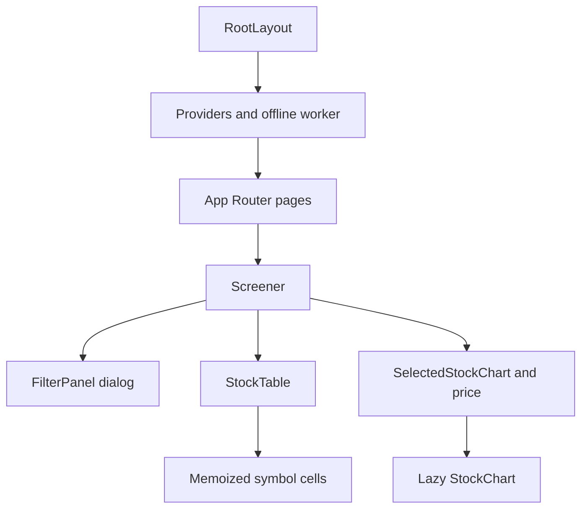
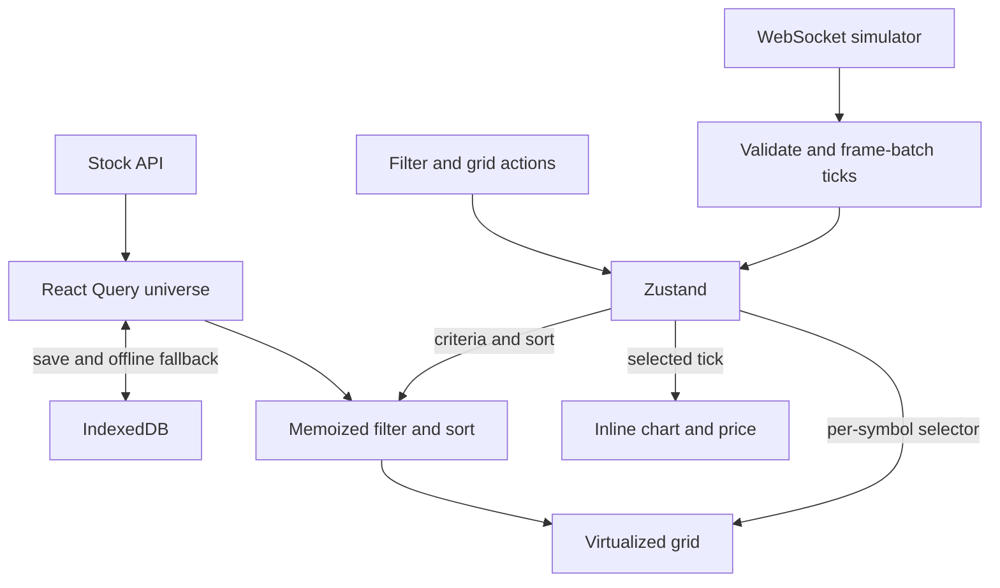

# ScreenerX

ScreenerX is an Indian-equity screening demo built with Next.js, React and TypeScript. It combines a deterministic 5,000-stock universe, client-side filters, a virtualized grid, simulated WebSocket prices and technical-analysis charts. All market data and historical candles are simulated.

**Verified on 10 November 2026:** 285 tests pass; lint and TypeScript pass. Aggregate coverage: **96.29% lines/statements, 91.94% branches, 86.12% functions** within the configured source scope. See [COVERAGE_REPORT.md](COVERAGE_REPORT.md) for exclusions and evidence. Browser performance targets and deployment have separate pending checks.

## Features

- 31 distinct screening criteria across fundamentals, market data, classification, technical signals and watchlist/recent-update flags; four presets.
- TanStack Table with row and column virtualization, pinned columns, resizing, three-state sorting, watchlist controls and keyboard navigation.
- Validated WebSocket messages, animation-frame batching, symbol-specific subscriptions and jittered exponential reconnect delays capped at 16 seconds.
- Candlestick charts with SMA, EMA, Bollinger Bands, RSI, volume profile, configurable settings, PNG export and line/rectangle drawings.
- Six chart timeframes: simulated five-minute candles for 1D; 5/21/63/252 weekday sessions for 1W/1M/3M/1Y; weekly aggregation over 1,260 sessions for 5Y. Exchange holidays are not modeled.
- IndexedDB stock-universe fallback and a production service-worker shell cache; watchlist persistence in localStorage.
- Accessible control names, filter-result announcements, modal focus handling, keyboard chart drawings, chart text summaries and reduced-motion support. Full WCAG conformance has not been manually verified.

## Product screenshots and deployment

Current product screenshots have not been captured for this README. The retained [Lighthouse evidence](PERFORMANCE_REPORT.md#lighthouse-and-web-vitals) is performance-audit output, not a product screenshot. Desktop grid, filter dialog and selected-chart screenshots remain pending; none are fabricated or presented as current UI captures.

There is no verified hosted deployment URL in this workflow. Local entry points are [http://localhost:3000](http://localhost:3000) and the optional production test port [http://localhost:3100](http://localhost:3100). Deployment belongs to Task 7.4.

## Setup

### Requirements

- Git and npm.
- Node.js **22.14.0** is the version used for the recorded checks. The installed jsdom test dependency requires `^20.19.0 || ^22.13.0 || >=24.0.0`; an older Node 20 release is insufficient for this test stack.
- Available local ports 3000 (web) and 3001 (stream), unless overridden.
- No API keys, database server or Docker services are required.

### Clone and start development

```powershell
git clone https://github.com/aditya-j-dev/ScreenerX.git
cd ScreenerX
npm ci
npm run dev
```

Open [http://localhost:3000](http://localhost:3000). `npm ci` installs the lockfile versions and runs the configured Husky preparation hook. `npm run dev` starts both Next.js and the standalone simulator; stop them with Ctrl+C.

To run the services separately, use two terminals in the repository root:

```powershell
# Terminal 1: web app
npm run dev:web
```

```powershell
# Terminal 2: WebSocket simulator
npm run dev:ws
```

If port 3000 is occupied, use `npm run dev:web -- -p 3002`; this changes the web port, not the WebSocket port.

### Production-style local run

```powershell
# Terminal 1: keep the simulator running
npm run dev:ws
```

```powershell
# Terminal 2: build, then serve the web app
npm run build
npm run start -- -p 3100
```

Open [http://localhost:3100](http://localhost:3100). `npm start` starts only Next.js; it does not start the simulator. Development output is in `.next-dev`; production build/start use `.next`. This prevents the development server from overwriting production chunks. The latest production rebuild was permission-blocked, so the current source has not yet passed final production verification.

## Environment variables

Local defaults work without an environment file.

| Variable                | Read by              | Default               | Configuration                                                                                                                           |
| ----------------------- | -------------------- | --------------------- | --------------------------------------------------------------------------------------------------------------------------------------- |
| `NEXT_PUBLIC_WS_URL`    | Browser bundle       | `ws://localhost:3001` | Set in `.env.local` or the web process environment before starting development or building production; rebuild production after changes |
| `WS_PORT`               | Standalone simulator | `3001`                | Integer 1–65535; set in its process environment before launch                                                                           |
| `WS_UPDATE_INTERVAL_MS` | Standalone simulator | `2000`                | Finite number >=50; mean interval per symbol, not one global broadcast interval                                                         |

The `tsx` simulator does not explicitly load `.env.local`. Set simulator variables in the terminal environment; do not assume Next.js environment loading configures that separate process.

Example using a custom stream port in PowerShell:

```powershell
$env:WS_PORT = "3003"
$env:WS_UPDATE_INTERVAL_MS = "1000"
$env:NEXT_PUBLIC_WS_URL = "ws://localhost:3003"
npm run dev
```

Alternatively, put only the browser setting in `.env.local`:

```dotenv
NEXT_PUBLIC_WS_URL=ws://localhost:3001
```

The public endpoint value is included in client JavaScript. The simulator uses compressed market time: each price step models 1/252 year, not two seconds of real market time.

For a hosted frontend, run the persistent WebSocket simulator separately and configure a reachable secure `wss://` endpoint before the web build. The browser's default `localhost` endpoint refers to the visitor's computer; it cannot serve remote visitors from a frontend deployment alone.

## Using the screener

1. Open **Filters**, enter numeric bounds or choose classification/technical criteria. Active filters apply immediately; **Any**, individual Remove controls and **Clear All Filters** reset criteria.
2. Click a column header to cycle ascending, descending and original order. Resize columns with their handles; open column options with right-click or Shift+F10 to pin/unpin. Symbol stays pinned.
3. Toggle a stock's watchlist control, then enable **Watchlist Only** to screen that selection. Watchlist membership persists across reloads; filters and live prices do not.
4. Click a stock row or press Enter from the focused grid to open its inline chart. Choose a timeframe, indicators or settings; **Export PNG** saves the composed chart. The separate `/[symbol]` route is still a placeholder.

| Keyboard control                                     | Action                                                            |
| ---------------------------------------------------- | ----------------------------------------------------------------- |
| Arrow keys in the focused grid                       | Move the active cell                                              |
| Home / End                                           | First / last row                                                  |
| Page Up / Page Down                                  | Move one viewport                                                 |
| Enter in the grid                                    | Open the active stock chart and move focus there                  |
| Space in the grid                                    | Toggle the active stock's watchlist membership                    |
| `?` in the grid                                      | Open keyboard help                                                |
| Shift+F10 / Context Menu on a header control         | Open column options                                               |
| Left / Right on a resize handle                      | Resize its column                                                 |
| Escape in filters, help or column options            | Close and restore focus                                           |
| Enter / arrows / Enter after choosing a drawing tool | Start at the middle candle, adjust endpoint, save; Escape cancels |

Native inputs and buttons retain their normal keyboard behavior; grid shortcuts only run when the grid itself has focus.

## Architecture

### Component hierarchy



The root layout mounts Providers around page content. Pages `/` and `/screener` render the same client screener; feature boundaries isolate the grid and chart.

### State and data flow



| State category | Owner                      | Contents                                                                        |
| -------------- | -------------------------- | ------------------------------------------------------------------------------- |
| Fetched data   | React Query                | Universe, loading/error state and five-minute stale time                        |
| Shared state   | Zustand + Immer            | Filters, sort, selected symbol, watchlist, connection, symbol-keyed live prices |
| Derived data   | `Screener` memoization     | Watchlist/recent flags and filtered/sorted records                              |
| View state     | Local React state/refs     | Filter visibility, grid focus/pinning/widths, chart settings/drawings           |
| Persistence    | localStorage and IndexedDB | Watchlist only in localStorage; complete fetched universe in IndexedDB          |

Selected chart and heading subscriptions are isolated from the grid's parent. Disabled indicators skip calculations. Watchlist persistence skips unchanged writes. See [ARCHITECTURE.md](ARCHITECTURE.md) for further implementation detail; [PERFORMANCE_REPORT.md](PERFORMANCE_REPORT.md) distinguishes code behavior from measured browser performance.

## Routes and source layout

| Location                                     | Purpose                                                                                              |
| -------------------------------------------- | ---------------------------------------------------------------------------------------------------- |
| `/`, `/screener`                             | Main screener                                                                                        |
| `/[symbol]`                                  | Placeholder detail route; inline chart is the working view                                           |
| `GET /api/stocks`                            | Mock 5,000-record universe in `{ success, data, meta }`                                              |
| `GET /api/stocks/[symbol]/history`           | 252 generated candles for an exact known symbol; 404 otherwise; main chart generates history locally |
| `src/components`, `src/hooks`, `src/stores`  | UI, network/cache hooks and shared state                                                             |
| `src/lib`, `src/__tests__`                   | Algorithms/helpers and automated tests                                                               |
| `server/simulator.ts`, `server/ws-server.ts` | Stream implementation and process entry point                                                        |
| `audit`, `scripts`, `progress`               | Retained measurements, audit scripts and task records                                                |

## Available scripts

| Command                 | Purpose                                                                |
| ----------------------- | ---------------------------------------------------------------------- |
| `npm run dev`           | Web development server and simulator together                          |
| `npm run dev:web`       | Web development server only                                            |
| `npm run dev:ws`        | Simulator only                                                         |
| `npm run build`         | Production build                                                       |
| `npm start`             | Serve a completed production build                                     |
| `npm run lint`          | Next.js ESLint checks                                                  |
| `npm run typecheck`     | TypeScript validation without emitted files                            |
| `npm test`              | Run the complete Vitest suite                                          |
| `npm run test:watch`    | Interactive test watch mode                                            |
| `npm run test:coverage` | Run suite, enforce coverage thresholds, generate HTML and JSON reports |
| `npm run prepare`       | Install Husky hooks; also runs during installation                     |

Storybook is not installed and there is no `storybook` script. It is optional Task 7.3; the README does not imply the command exists.

## Testing and performance evidence

```powershell
npm run lint
npm run typecheck
npm run test:coverage
```

Latest run: **285/285 tests pass across 23 files**, including real local WebSocket client/server tests and the production filter-to-grid workflow. Vitest enforces an aggregate 70% floor for lines, statements, functions and branches.

- [COVERAGE_REPORT.md](COVERAGE_REPORT.md): results, test boundaries and excluded source areas.
- [coverage/coverage-summary.json](coverage/coverage-summary.json): retained machine-readable coverage. Generated `coverage/index.html` is available after running coverage and is ignored by Git.
- [PERFORMANCE_REPORT.md](PERFORMANCE_REPORT.md): supplied Lighthouse run, algorithm comparisons, baseline bundle treemap and missing measurements. A supplied run scored 100 Performance but warned about IndexedDB state; no controlled final-build improvement is claimed.

To record a new pure-function benchmark without overwriting the baseline:

```powershell
node --import tsx scripts/audit-algorithms.mjs --output audit/algorithm-results-post-6.2.json
```

## Offline behavior

A full offline reload requires a successful prior online **production** visit. The service worker caches the shell and requested Next static assets; IndexedDB separately stores the universe. Open a chart online first if its lazy chunks must be available offline. API responses are not service-worker cached. Development mode unregisters service workers.

Cached fallback shows a stale-price warning even if the browser reports online. Successful network data remain usable if cache writes fail, and reconnecting refreshes the universe. The watchlist uses localStorage key `stock-screener`; IndexedDB uses database `pulse-screener-cache`, store `stock-universe`. Worker cache prefix is `screenerx-shell-`; deployment changes require deliberate version/update handling.

## Technology decisions and trade-offs

| Choice                        | Reason                                                | Trade-off                                                                     |
| ----------------------------- | ----------------------------------------------------- | ----------------------------------------------------------------------------- |
| Next.js App Router            | Routes, API and frontend in one repository            | Static/API caching and build modes need explicit verification                 |
| React Query                   | Fetched-data lifecycle and reconnect refresh          | Separate from streaming/UI state                                              |
| Zustand + Immer               | Granular subscriptions and Map/Set updates            | Broad selectors can still trigger extra work                                  |
| TanStack Table + Virtual      | Large-data grid with custom rendering                 | Geometry, keyboard access and pinning require custom integration              |
| Lightweight Charts            | Financial canvas charting, loaded on selection        | Indicator settings, annotations and accessible alternatives require custom UI |
| Client-side filtering/sorting | Small local universe and immediate criteria changes   | Entire snapshot is transferred; changing scale requires new measurements      |
| Vitest + Testing Library      | Utility, component and real-wiring integration checks | jsdom tests do not measure rendered FPS, browser gestures or conformance      |

## Known limitations and future improvements

- Snapshot fields drive live-price filtering and sorting; live cells and chart ticks do not merge all snapshot fields into a fresh universe. The recent-update flag currently has no expiry.
- Baseline decoded stock JSON is approximately 4.22 MB. Transfer/parse improvements require measurement before changing the API contract.
- The API has a module-local five-minute cache, but the baseline production route was statically prerendered with no revalidation. Do not treat this as a verified request-time freshness policy.
- The port-3100 chart issue was deferred. Output folders were separated, but the current production build/browser behavior remains unverified after an `EPERM` build failure.
- If streaming stays disconnected, check the simulator terminal, port and `NEXT_PUBLIC_WS_URL`. A working web page alone does not prove the stream process is running.
- If a build reports `EPERM`, stop processes using its output directory and retry; investigate filesystem permissions or locks if it persists. A restart is not a verified fix for every permission failure.
- Product screenshots, live screen-reader validation, browser-level E2E checks, memory/paint-latency traces and a controlled performance comparison remain pending.
- Task 6.4 Responsive Design was explicitly skipped; existing responsive classes/swipes are not proof of breakpoint acceptance.
- Storybook is optional and pending. Deployment and final repository transfer have not been completed in this workflow.

## Project documentation

- [Architecture](ARCHITECTURE.md)
- [Performance report](PERFORMANCE_REPORT.md)
- [Coverage report](COVERAGE_REPORT.md)
- [Accessibility task record](progress/task-6.3.md)
- [Errata](ERRATA.md)
